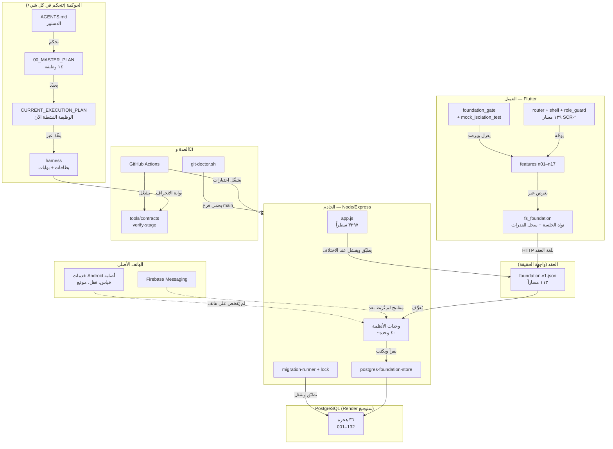
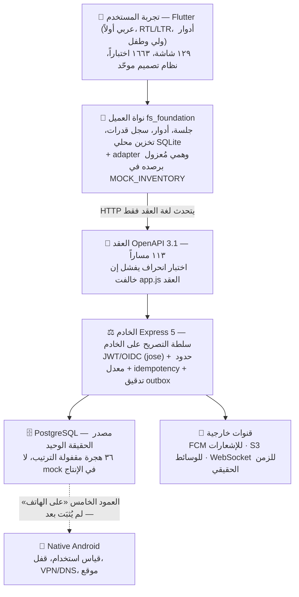

# الخريطة المعمارية المعرفية — Family OS

> **طبيعة الوثيقة:** شاهد تحليلي مُولَّد في 2026-10-19 (جلسة تحليل معماري شامل).
> **ليست سلطة تنفيذية** — السلطة حصراً لما في [`../README.md`](../README.md).
> الأدلة: قراءة مباشرة لـ`backend/src`، `backend/openapi/foundation.v1.json`، `backend/db/migrations`، `app/lib`، `app/pubspec.yaml`، `docs/00_MASTER_PLAN.md`، `docs/CURRENT_EXECUTION_PLAN.md`.

---

## ١) هوية المشروع في سطر

**Family OS** تطبيقٌ سوبر عائلي عربي-أولاً: Flutter (المنتج) + Node.js/Express (السلطة) + PostgreSQL (الحقيقة) + قدرات Android أصلية حيث يلزم، يُسلَّم **وظيفةً وظيفة** عبر بوابتين (التوصيل السطحي، بيئة PostgreSQL الحقيقية) ومقياس صدق من خمسة أعمدة.

## ٢) عُقد الخريطة المعرفية (الأصناف والمثيلات)

| الصنف | العُقد | الدليل |
|---|---|---|
| **حوكمة** | AGENTS.md (الدستور) · 00_MASTER_PLAN (١٤ وظيفة) · CURRENT_EXECUTION_PLAN (المؤشر الحيّ) · docs/README (خريطة الوثائق) · harness (البطاقات والبوابات) · MOCK_INVENTORY · PHONE_CHECKS | `docs/` |
| **أنظمة إنتاجية و١–و١٤** | العائلة والهوية · جهاز الطفل · الموقع والمناطق الآمنة · SOS · وقت الشاشة · فلترة الويب · المهام والنقاط · التقويم · الدردشة المرخّصة · التعلم · القرآن · اقتصاد الدقائق (التوقيع الفريد) · اليوم · الخصوصية | `00_MASTER_PLAN.md` |
| **خدمات الخادم** (~٤٠ وحدة) | family-invite-codes · pairing-code · membership-roster · device-lifecycle · device-capabilities · command-lifecycle · device-revocation · safe-zones · location-telemetry · sos-emergency · screen-time · web-filter · tasks · calendar · family-chat(+realtime/media/S3) · push-registrations · notification-dispatcher · fcm-sender · child-consents · data-erasure · permission-policy · minutes-economy · minutes-service · ai-events · audit-outbox · collaboration-policy | `backend/src/*.js` |
| **طبقة التخزين** | `store/postgres-foundation-store.js` (المتجر الحقيقي) · `store/unconfigured-foundation-store.js` (يُغلِق صريحاً عند غياب القاعدة) · migration-runner + migration-lock + schema-manifest | `backend/src/store/` |
| **الهجرات** | ٣٦ هجرة مرقّمة: 001–008 تأسيس (عضوية، ولاية، تدقيق، رفوف أطفال، تلمتر جهاز، إقران) · 100–124 أنظمة السلامة والبيت · 130–132 دفتر الدقائق والمحافظ | `backend/db/migrations/` |
| **العقد** | `openapi/foundation.v1.json` — OpenAPI 3.1.0، **١١٣ مساراً** `/v1/*` + مساري صحة | `backend/openapi/` |
| **عميل Flutter** | `app/` (router + family_shell + role_controller/role_guard) · `core/fs_foundation` (نواة الجلسة، سجل القدرات، قاعدة SQLite محلية، mock_remote_adapter) · `core/{identity,location,screen_time,web_filter,sos_final,design,i18n,compliance,…}` · `features/n01–n17 + quran + shared_onboarding` · `foundation_gate/` | `app/lib/` |
| **المرجع المجمّد** | `family-os/` و`prototype/` — سجل المسارات `SCR-*` (١٢٩ مساراً `/scr-*`) الذي تربطه اختبارات Flutter | `prototype/` |
| **العدة** | `tools/contracts` (verify-stage: اختبار انحراف العقد↔app.js) · `tools/git/git-doctor.sh` (حارس الدفع) · `tools/harness` (حلقة البطاقات) · `tools/android` | `tools/` |
| **البيئة وCI** | Render (ستيجنغ) + PostgreSQL مُدار · GitHub Actions: فحوص الخادم، اختبارات Flutter، Foundation Gate، Git Guard CI | `.github/workflows/` |

## ٣) الحواف — علاقات العُقد

## ٤) المعمارية بالطبقات

## ٥) مصفوفة الأنظمة الـ١٤ × الطبقات (مقياس الصدق)

| الوظيفة | الجدول | العقد | العميل | الشاشة+الرحلة | على الهاتف |
|---|:-:|:-:|:-:|:-:|:-:|
| و١ العائلة والهوية | ✅ | ✅ | ✅ | ✅ | ⚠️ ف٠ بانتظار |
| و٢ جهاز الطفل | ✅ | ✅ | ✅ | ✅ | ◐ |
| و٣ الموقع والمناطق | ✅ | ✅ | ✅ | ✅ | ◐ |
| و٤ SOS | ✅ | ✅ | ✅ | ✅ | ❌ |
| و٥ وقت الشاشة | ✅ | ✅ | ✅ | ✅ | ❌ |
| و٦ فلترة الويب | ✅ | ✅ | ✅ | ✅ | ❌ |
| و٧ المهام والنقاط | ✅ | ✅ | ✅ | ✅ | — |
| و٨ التقويم | ✅ | ✅ | ✅ | ✅ | — |
| و٩–و١٤ | ⬜ | ⬜ | ⬜ | ⬜ | ⬜ |

✅ = مُثبَت بجِدّية اختبارية · ◐ = كود موجود لم يُفحَص على هاتف · ❌ = غير موجود · — = لا يلزمه عمل أصلي.
**المعنى المعماري:** الأعمدة الأربعة الأولى (خادم→عقد→عميل→سطح) قاعدة مشتركة مكتملة لثمانٍ من أربع عشرة؛ الفجوة الكلية اليوم **رأسية واحدة**: العمود الخامس (دورة الحياة الأصلية + الأدلة على جهاز حقيقي) وربط مفاتيح FCM. المصدر الحيّ: [`../CURRENT_EXECUTION_PLAN.md`](../CURRENT_EXECUTION_PLAN.md).

## ٦) تدفّق حقيقي (مثال: SOS)

1. **الطفل** يضغط زر SOS في `features/n10_emergency` (شاشة `SCR-CHD-005`).
2. **العميل** يرفع الطلب عبر `core` بمسار العقد `POST /v1/devices/{deviceId}/sos-alerts`.
3. **الخادم** (`sos-emergency.js`) يتحقق من التوكن والصلاحية (`permission-policy`)، يكتب في جدول SOS عبر المتجر الحقيقي، ويصدر حدثاً في ناقل الإشعارات (`notification-dispatcher` → `fcm-sender`).
4. **وليّ** يقرأ الحادث الحيّ بحالاته الصادقة (`/v1/families/{familyId}/sos-alerts/{alertId}`)، ويؤكد ويصعّد ويحلّ — كل ذلك أحداث تدقيق على PostgreSQL (رحلة ١١/١١ في CI).
5. **فجوة اليوم:** الحلقة ٢→٤ تعمل على الخادم؛ إشعار FCM الحي والرفع الفعلي من هاتف الطفل لم يُثبَتا على جهاز حقيقي (عمود «على الهاتف» = ❌).

## ٧) خصائص معمارية لافتة

- **العقد قلب المعمارية لا نتيجة جانبية:** ١١٣ مساراً في `foundation.v1.json` يطابقها `app.js` تحت فحص انحراف آلي (`tools/contracts/verify-stage` + `route-inventory.js`) — الاتجاه النموذجي معكوس: العقد يُعرِّف والخادم يُطابَق به.
- **التصريح على الخادم:** العميل «يشرح» الإذن ولا يقرره؛ `permission-snapshot` مسار أول-الصفحة للولي.
- **إغلاق صريح لا هدوء خادع:** `unconfigured-foundation-store` يفشل بصوت عالٍ عند غياب القاعدة — لا mock يعمل خفيةً في الإنتاج، والـmock الباقي مرصود عدداً في `MOCK_INVENTORY` ويحرسه `mock_isolation_test.dart`.
- **صدق البيئة تنفيذاً لا كتابةً:** الـCI يشغّل رحلات PostgreSQL حقيقية لكل وظيفة (SOS ١١/١١، التقويم ١٦/١٦، المهام ١٥/١٥، الدقائق…) — الهجرة غير المنفّذة ليست دليلاً.
- **الحوكمة بحاجز آلي داخل المستودع:** `git-doctor.sh` + `.githooks/pre-push` يمنعان force-push على `main` وحذف الوسوم آلياً، وGit Guard CI يجري ذاته على كل PR.
- **النموذج المجمّد أصلٌ لا خردة:** سجل `SCR-*` في `prototype/` مصدر اختبارات الوصل السطحي (١٢٩ مساراً قابلة للوصول) — مبدأ «لا تُحذف، بل ابنِ» محفوظ آلياً.

## ٨) الخلاصة المعمارية

المعمارية **صحيحة الاتجاه ونادرة الانضباط**: عقد مركزي، سلطة خادمية، حقيقة علائقية واحدة، وعميل يتبع العقد — مع ذكاء حوكمة يمنع عودة الـmock ويوزن كل ادّعاء بخمسة أعمدة. العقد الاجتماعي للمشروع أضيق من نظيره التقني: ثماني وظائف من أربع عشرة حقيقية «سحابياً»، و**لا واحدة** مكتملة «هاتفياً» بعد، وهو ما يعلنه المشروع بنفسه بشفافية في مقياس الصدق — فتعمل البنية فعلاً كأداة قياس، لا كديكور.

